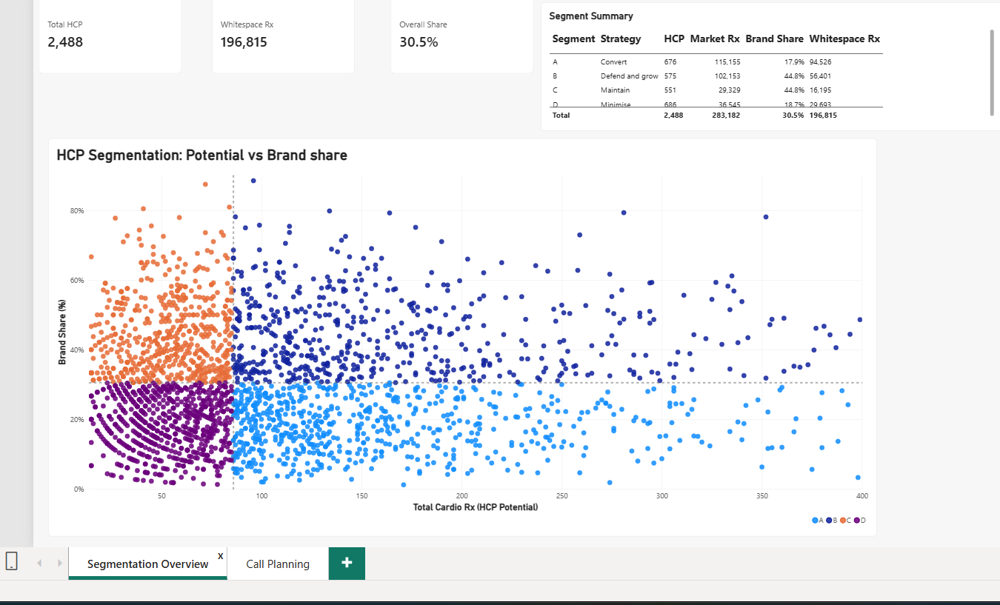
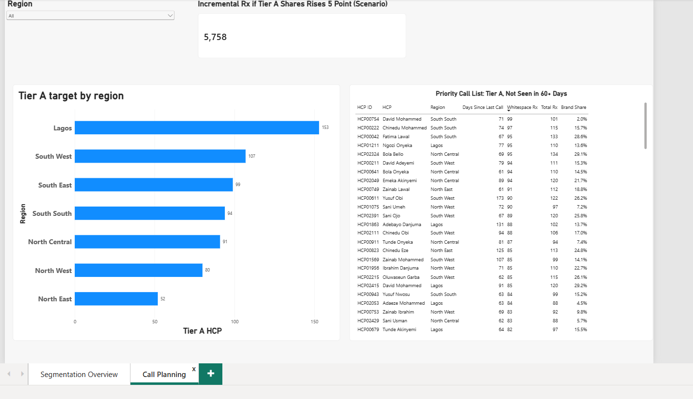

# HCP Segmentation for Sales Call Planning

## Business problem
Sales reps spread call effort evenly across cardiologists, regardless of
prescribing potential. This wastes travel time on low-value HCPs while
high-potential, low-share HCPs go unvisited.

## Key finding
**Tier A (high potential, low share) holds 41% of market volume but only
17.9% brand share.** If Tier A share rose by 5 points, that would add
roughly **5,800 prescriptions** (range: about 3,500 at 3 points to 11,500
at 10 points). This is a scenario, not a forecast.

## Data
2,500 synthetic cardiologist records (total cardio Rx, brand Rx,
competitor Rx, digital engagement, days since last call, region).
After removing 12 duplicate CRM copies: 2,488 HCPs.

## Tools
PostgreSQL (pgAdmin) for cleaning and segmentation; Power BI for the dashboard.

## Method
1. **Data quality** - found and removed 12 duplicate HCP records; 125 blank
   digital engagement values left as NULL (not used in the analysis).
2. **Scoring** - brand share = brand Rx / total Rx.
3. **Segmentation** - 2x2 matrix on potential (total Rx) and share.
4. **Recommendation sizing** - uplift scenarios and call-effort analysis.

## Assumptions
- High potential = total cardio Rx at or above the median (86 Rx).
- High share = HCP share at or above overall brand share (30.5%).
- Target cadences and the 3/5/10-point uplifts are planning scenarios,
  not derived from the data.
- Dataset holds days since last call, not call counts, so freed-visit
  estimates are illustrative.

## Segments
| Segment | Strategy | HCPs | % of market Rx | Share | Whitespace Rx |
|---|---|---|---|---|---|
| A: High potential / Low share | Convert | 676 | 40.7% | 17.9% | 94,526 |
| B: High potential / High share | Defend and grow | 575 | 36.1% | 44.8% | 56,401 |
| C: Low potential / High share | Maintain | 551 | 10.4% | 44.8% | 16,195 |
| D: Low potential / Low share | Minimise | 686 | 12.9% | 18.7% | 29,693 |

## Recommendation
- **Misallocated effort:** 293 of 686 Tier D HCPs (43%) were called in the
  last 30 days, while 124 Tier A HCPs have not been seen in over 60 days.
- **Action:** shift field visits from Tiers C and D to Tier A; serve D
  digitally; prioritise the 124 overdue Tier A HCPs (call list in `docs`).
- **Regional focus:** Lagos holds the most Tier A targets (153), followed
  by South West (107) and South East (99).
- **Impact (scenario):** about 3,500 to 11,500 incremental Rx from Tier A
  share gains, with field time freed from low-value visits.

## Dashboard

## Repository
- `sql/` numbered scripts 01 to 06
- `powerbi/` dashboard file
- `data/` dataset
- `docs/` screenshots and exported results